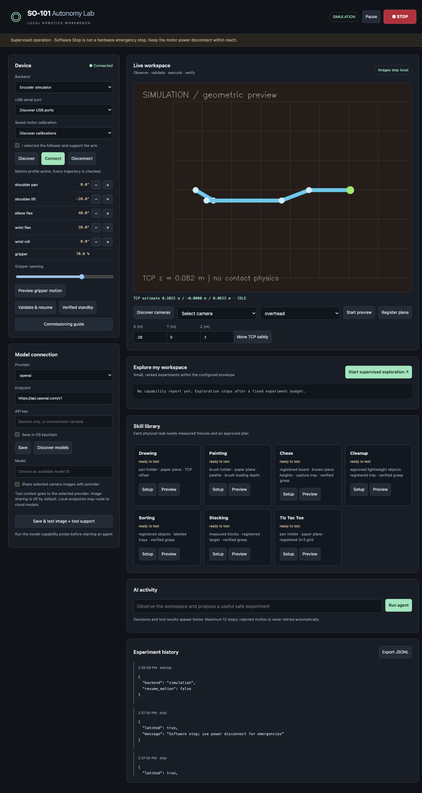

# SO-101 Autonomy Lab

A local robotics workbench for the Hugging Face SO-101 follower: six motor controls,
URDF kinematics, camera registration, bounded exploration and multimodal tool-calling agents.
Python owns motion and safety. Models propose actions through a fixed, validated tool API.

**Experimental software. Simulator and stub validation do not establish physical safety.**
Physical operation requires an operator, saved LeRobot motor calibration, verified motor-to-model
mapping, commissioned limits, and a fresh camera. Software Stop is not a hardware emergency stop.

## Start in simulation

Install [uv](https://docs.astral.sh/uv/getting-started/installation/), then:

```sh
git clone https://github.com/Noptus/so101-autonomy-lab.git
cd so101-autonomy-lab
uv sync --locked
uv run so101-lab
```

Open http://127.0.0.1:8765. No Node.js, cloud account or arm is needed for deterministic simulation.
The default simulator represents encoder motion and geometry; it does not simulate force, paint or grasps.



## What is implemented

- **SO-101 controls:** five arm jog controls, a separately gated gripper, six calibrated
  encoder positions, Cartesian moves, measured standby, health/freshness checks and
  a latched Stop independent of model responses.
- **Hardware transport:** official LeRobot 0.7.0 SO101Follower/Config, Feetech extra,
  USB discovery, saved motor calibration and exclusive serial ownership. A supervised
  connection seeds measured positions before torque configuration.
- **Motion:** original SO-101 URDF, explicit motor mapping and TCP, bounded numerical
  IK, quintic trajectories, configured geometry/obstacles and encoder verification.
- **Cameras:** USB previews and roles, ArUco detection, measured planar registration
  with independent validation, intrinsics estimation API and color-region estimates.
- **Models:** native Anthropic plus OpenAI-compatible presets for OpenAI, Gemini,
  OpenRouter, Mistral, xAI, Groq, Together, Ollama, LM Studio and custom servers.
  Actual model IDs are discovered; image + structured-tool support is probed.
- **Agent harness:** validated tool allowlist, images with explicit sharing, persistent
  sessions, token usage, optional supplied-price cost estimates, bounded tool loops,
  timeouts, recorded feedback and no autonomous shell or safety edits.
- **Exploration:** ranked finite free-space experiments, single-axis trials followed
  by small coordinated/Cartesian primitives, persistent evidence and capability reports.
- **Seven planners:** Drawing, Painting, Chess, Cleanup, Sorting, Stacking and
  Tic-Tac-Toe. Exact-plan contact approval and explicit physical verification are
  separate from geometric execution.
- **Persistence:** SQLite events/configuration, before/after images, portable JSONL
  export and simulation-only replay.

## Validation status

**No SO-101 is plugged in yet. No real arm was moved.** This is an experimental
implementation with tested simulation and mocked hardware, ready for supervised
commissioning when an arm is available.

| Area | Evidence | Still needs physical validation |
|---|---|---|
| Core and seven skills | Automated geometric execution/rejection tests | Ink, grasp, contact and task outcomes |
| LeRobot transport | Installed 0.7.0 signatures and stub behavior tests | Actual USB, motor feedback, calibration and hold behavior |
| Motion | FK/IK, limits, interpolation, exclusion and interruption tests | Mapping, TCP, backlash, fixtures, force and collision envelope |
| Cameras | Synthetic ArUco, homography, segmentation and stale-frame tests | Actual cameras, lighting and held-out physical registration |
| Models | HTTP protocol tests, cancellation/deadline tests, live probe implementation | Owner-supplied keys and selected live models |
| MuJoCo | Optional joint-dynamics smoke test | Validated physical dynamics and object contact |

Collision checks use link capsules and sampled trajectories, not continuous full-mesh
collision detection. Visual object classification does not establish graspability.
Physical game boards and objects start from measured/manual registration. Automatic
full-board chess recognition, force control, automatic calibration, policy training
and a LeRobot training-dataset converter are not implemented. See
[Safety](docs/SAFETY.md) for practical limits.

## Connect a real arm later

```sh
uv sync --locked --extra hardware
uv run --extra hardware so101-lab
```

Follow [Hardware commissioning](docs/HARDWARE.md). The app requires a saved official
LeRobot calibration, measured motor signs/offsets, a commissioned workspace, an actual
standby pose and fresh camera frames. It starts in simulation even when an arm is
plugged in. It never guesses a safe home pose or automatically resumes after a fault.

Hardware operation also requires a visible dashboard with the operator checkbox
active. Contact/gripper plans need one-use approval of the specific previewed path.
Only independent operator evidence can mark a physical skill validated.

## Documentation

- [Installation, models and troubleshooting](docs/SETUP.md)
- [Hardware and camera commissioning](docs/HARDWARE.md)
- [Safety behavior and limits](docs/SAFETY.md)
- [Architecture, new skills/providers and recording](docs/ARCHITECTURE.md)
- [Progressive exercise manual for all seven skills](docs/EXERCISES.md)
- [Research, design choices, sources and licenses](docs/RESEARCH.md)
- [Instructions for coding agents](AGENTS.md)

The dashboard is plain HTML/CSS/JavaScript served by FastAPI. REST schemas are at
`/docs`; live events use `/ws`. Config YAML files document defaults; measured runtime
configuration is saved through the dashboard/API to the ignored local database.

macOS and Linux are the primary hardware targets. Core simulation is intended for
Windows too; native Windows hardware is unvalidated. Python 3.12–3.13 is pinned.
The optional MuJoCo backend is installed with `--extra mujoco` and models approximate
joint dynamics without gravity, grasp or contact physics.

## Development

```sh
uv sync --locked --all-extras
uv run --all-extras pytest -q
uv run ruff check src tests examples scripts
uv run ruff format --check src tests examples scripts
uv run python examples/demo.py
uv run --extra hardware python scripts/inspect_lerobot.py
```

Automated tests must never operate physical hardware. They cover successful geometry
and rejection behavior: invalid targets, stale cameras/encoders, missing calibration,
disconnection, Stop, interruption, provider deadlines, tool validation and recording.
CI runs core checks across macOS/Linux/Windows and hardware-API tests on macOS/Linux.

Source: GPL-3.0-or-later. The original SO-101 robot model is Apache-2.0 with preserved
[asset attribution](src/so101_lab/assets/ATTRIBUTION.md). Inspired by and researched
against [LeRobot](https://github.com/huggingface/lerobot),
[so101-control](https://github.com/vi-vi-3482/so101-control), and
[so-paint](https://github.com/pham-tuan-binh/so-paint).
