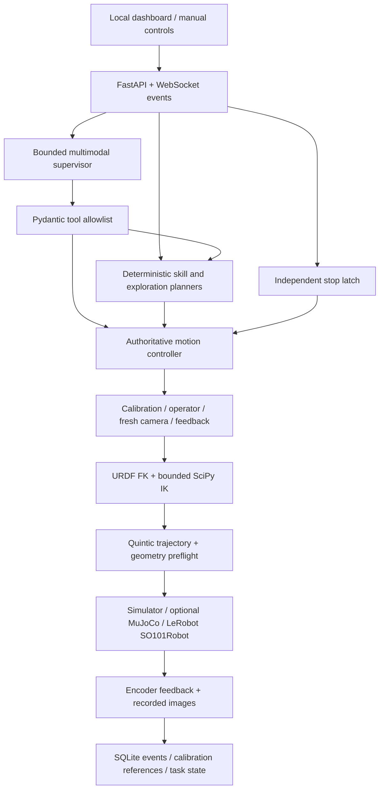

# Architecture

`Lab` owns the lifecycle, camera service, memory, providers, planners and motion
controller. The robot abstraction contains transport only. Both real and simulated
robots expose get_state/move_joints/move_tip/set_gripper/get_tool_pose/stop/disconnect;
convenience moves delegate to the bound controller. Importing hardware modules does
not connect anything.

The API launches long operations in tasks/worker threads. HTTP Stop and WebSocket
updates remain responsive to provider latency. Sensor/driver calls are serialized
with backend I/O locks; the model never runs the 30 Hz trajectory loop.

## Kinematics decision

LeRobot's RobotKinematics uses Placo. so101-control provides a useful degree-based
wrapper and documents its packaging issues. We use the original SO-101 URDF with
SciPy least_squares for five-axis FK/IK in the common simulator/hardware path. This
keeps Placo, Pinocchio and mesh loader dependencies out of a laptop install while
retaining identical local position/orientation residual checks across backends.
IK uses current-pose seeds, explicit motor signs/offsets, URDF and commissioned
bounds, then rejects residuals above 1 mm / 5 degrees. Those are mathematical
solver tolerances, not measured physical robot accuracy. Gripper position is carried
through unchanged by IK. Tool offsets are applied in the tool frame.

Trajectory velocity/acceleration bounds are enforced analytically by time stretching.
Cartesian strokes are subdivided before joint interpolation. Known geometry is
checked before execution and measured feedback is checked during execution. Read
SAFETY.md for collision-model limitations.

## Providers and state

Native Anthropic Messages and OpenAI-compatible Chat Completions share a normalized
tool transcript. Provider IDs are discovered dynamically; support for images and
tools is tested with a synthetic probe. Private provider reasoning fields are discarded.
Images are sent only with sharing enabled. The model receives concise observation
and execution feedback, not arbitrary process/file/shell tools.

The supervisor has fixed step/call budgets and provider timeouts. Rejected actions
end the current loop with an operator/replan state. It does not replay a partly
executed contact task after errors. Token counts use provider-reported usage; cost is
unknown unless input/output prices are supplied in ProviderConfig. Session messages
and outcomes persist to SQLite; restart marks unfinished sessions interrupted and
always starts a simulator. Hypotheses cannot update safety configuration.

Skill plans are fully preflighted. Contact approval applies to an exact draft, expires
after 120 seconds and is invalidated if the robot moves. Setups, validation status
and simulation/hardware data are separate. Actual physical results require independent
operator evidence. Chess board and tic-tac-toe states advance only after verified
hardware outcomes; simulation records the proposed next state in metrics.

## Extending

Add a deterministic planner and preconditions to skills/planners.py; return local
Cartesian/joint requests and completion metrics. Register it in SKILLS, document its
fixtures, add a geometric execution test and a missing-prerequisite rejection test.
Never route a skill directly to robot.send.

For a provider, prefer a compatible endpoint preset when possible. Otherwise add a
transport that normalizes images, tool calls/results and usage. Test with HTTP stubs
and preserve endpoint-scoped secret handling, redacted errors and timeouts. New
provider/model combinations must pass the same image/tool probe.

## Recordings

`/api/recordings/export` streams all events as JSONL in ascending ID order, including
motor feedback timestamps, planned commands, outcomes and references to local image
files under `.so101-lab/observations/`. `recording.episodes.replay_simulation` replays
motion events only against simulation and rejects physical backends. Hardware
recordings are evidence, never automatic recovery scripts.

This is a portable event format, **not** a LeRobot dataset. LeRobot training export
requires a separate conversion step (synchronized image/video, fixed features/fps,
task metadata and dataset validation). That converter is not implemented in 0.1.
